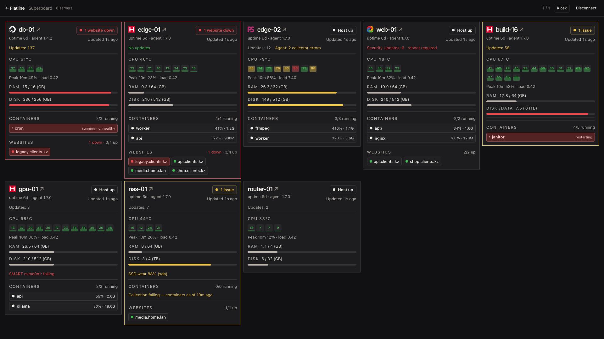
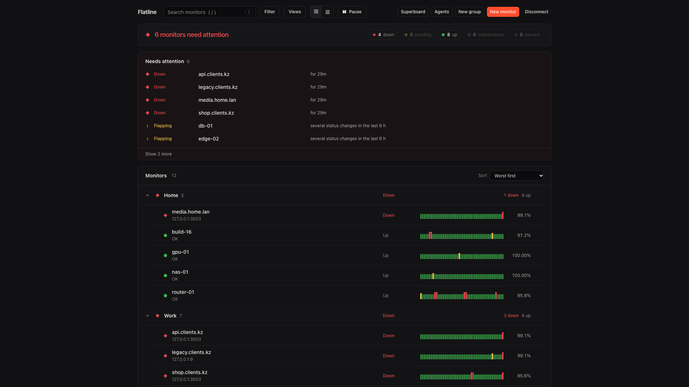
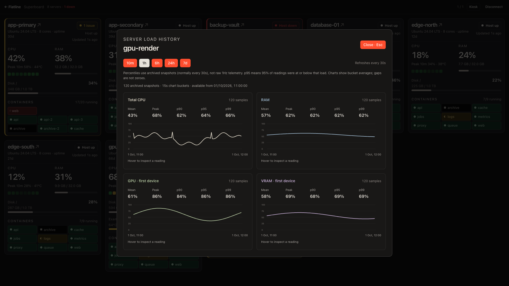

<div align="center" width="100%">
    
</div>

# Flatline

Self-hosted uptime monitoring, live server telemetry, and Telegram alerts—built for shared operators and AI agents.

A fork of [Uptime Kuma](https://github.com/louislam/uptime-kuma) (MIT), trimmed down to what a
small team actually uses and extended where it fell short. See [FORK-ROADMAP.md](./FORK-ROADMAP.md)
for the full list of changes.



**All screenshots use generated sample data**, not a production installation.

## What you can do

- Monitor websites and services from a dense, keyboard-friendly dashboard.
- Watch CPU/RAM at 1Hz on **Superboard**, including per-core load, disk usage,
  optional GPU/VRAM, temperatures, and explicit telemetry freshness.
- Open a server's history with **10m / 1h / 6h / 24h / 7d / 30d / 1y** ranges
  and **p90 / p95 / p99**, mean, and peak summaries. Windows beyond a week
  read hourly rollups (two-year retention); peak stays the true maximum.
- Track containers in three-column status tiles with automatic vertical looping,
  pinned problems, and no manual scrolling; each tile shows a compact CPU /
  memory reading when the agent can measure it. Host reachability stays
  separate from workload health.
- See pending OS update counts per host (`No updates` / `Updates: N` /
  `Security Updates: N`), read-only, from agent 1.3.
- Get paged on sustained resource pressure: per-server CPU / RAM / disk
  thresholds evaluated server-side, with 60-second debounce, 30-minute
  cooldown, hysteresis, and explicit recovery messages through the same
  Telegram path as host alerts.
- Spot agent trouble at a glance: version, dropped samples, failed pushes and
  per-collector error counts travel in every payload and render on the card
  when something is off.
- Read load average and live network / disk I/O throughput on each server
  card (rates derived server-side from raw counters, virtual interfaces
  excluded so container traffic is not double counted).
- See per-container CPU / memory on the container tiles, and a SMART warning
  when a disk reports failing health or heavy SSD wear (NVMe).
- Wall-mount a group of servers on its own kiosk page —
  `/superboard/kiosk/work` — while home shows every fleet on one board,
  or combine scopes with `/superboard/kiosk/work,personal`.
- Rename servers on the board directly (right-click → Rename).
- Share monitor data across accounts without sharing passwords or API tokens.
- Publish client status pages with password gates, branding, and group-driven
  generation; manage the installation through scoped REST calls. Status pages
  live in the dashboard app (`/status/:slug`, plus host-routed client
  domains).

### Operator dashboard

Grouped monitors, bulk actions, search (`/`), and live status updates.



### Server history

Percentiles use archived readings (normally every 30 seconds), **not raw 1Hz
samples**. Charts show bucket averages; missing readings are not zeroes.
The card's **Peak 10m** tracks the highest total CPU load observed in the last
ten minutes, not the currently busiest core.



[Screenshot fixtures and regeneration instructions](docs/screenshots/README.md).

## What is different from upstream

- **Telegram only.** All 108 other notification providers were removed, along with the Webpush
  service worker and its VAPID infrastructure. Fewer moving parts, one way to be paged.
- **Multiple real users.** Flatline adds operator-issued, single-use invite links: mint a link, send it over any channel
  you already trust, the recipient picks their own password. No email required, no signup form.
- **REST API v1.** Everything the dashboard does is available over HTTP with bearer-token
  auth and per-token `read` / `write` / `publish` scopes, so scripts and LLM agents can drive it.
  `GET /api/v1/openapi.json` documents itself.
- **Shared instance.** There are no per-user silos: every operator sees and edits the same
  monitors, notifications and maintenance windows. Multiple accounts exist so panel access
  can be shared without passing around one password. Tokens and invite links stay per-user
  as the audit trail.
- **Flatline branding.** Hot-orange accent on warm near-black, following the palette of
  [1410666.xyz](https://1410666.xyz).

Retains upstream monitor types such as HTTP(s), TCP, DNS, Ping, Push, Docker,
SFTP, NTP, Postgres, and Redis, plus maintenance windows, proxy support, and 2FA.

## ⭐ Features

- Monitoring for HTTP(s), TCP, HTTP(s) Keyword, HTTP(s) Json Query, Websocket, Ping, DNS Record,
  Push, Steam Game Server, Docker Containers, gRPC, MQTT, PostgreSQL, MySQL, MS SQL, MongoDB,
  Redis, RabbitMQ, Kafka, SFTP, NTP, Oracle DB and more
- Telegram notifications with templates and MarkdownV2
- REST API v1 with token scopes and a self-describing OpenAPI document
- Server-side metric threshold alerts (CPU / RAM / disk) with debounce,
  cooldown and recovery messages
- Multi-user with single-use invite links
- Multiple status pages, maintenance windows, tags, proxy support, 2FA
- Configurable check intervals; 1Hz host telemetry does not accelerate website checks

## Architecture

One process (v2 consolidation): the backend serves the API and the web app —
operator dashboard and public status pages — on one origin.

| App | Dir | Port | What |
|---|---|---|---|
| Backend + web app | `server/`, `apps/dashboard/` | 3001 | Monitors, checks, notifications, REST v1, and the built SPA (dashboard, `/status/:slug`, host-routed client domains). |

The dashboard uses bearer-authenticated HTTP. Sign in with the operator
password to obtain a browser token — the username is only asked for when the
instance has several accounts; integrations use per-user API keys from
`POST /api/v1/api-keys` or the **Agents** panel. Public status pages are
routes in the same app; they read the status-page API, and password-gated
pages use page-scoped unlock cookies rather than granting visitors operator
access. In development the Vite dev server runs separately on 3003; the
release image serves the build from the backend.

### Live updates

The operator dashboard and Superboard use bearer-authenticated SSE
(`/api/v1/events`) rather than roster polling. REST snapshots recover state on
connect/reconnect; heartbeat changes arrive as soon as checks finish.
External monitor check frequencies do not change.

[Superboard agent 1.5](superboard/README.md) pushes raw CPU counters at 1Hz
(the server derives utilization: responsive live, ~30s means in history),
1-second-fresh RAM, load average, network and disk I/O counters (server
derives live rates), independent slower collectors, read-only pending-update
counts every 4h, and a Telegraf-style self-report (version, uptime, dropped
samples, collector errors) that cards surface as version + warning lines.
Delivery is disk-backed: backend outages and agent restarts become late
history instead of missing history, and backfilled samples carry their real
times (`sampledAt`). Latest samples are cached; live history is
sampled every 30s and retained for 30 days, with hourly rollups kept for two
years. Existing explicit agent intervals
are preserved until changed. Upgrade the backend before enabling 1Hz agents.

Use a single backend process. If reverse-proxying `/api/v1/events`, disable
response buffering and allow connections longer than the 15s keepalive.

The benchmark reports HTTP-ingest-to-stream latency, not remote collection or
browser paint latency. See [SUPERBOARD-SPEC.md](SUPERBOARD-SPEC.md) for limits
and restart/durability behavior.

## 🔧 How to Install

Documentation: [dashboard](apps/dashboard/README.md) ·
[agent installation](superboard/README.md) · [Superboard specification](SUPERBOARD-SPEC.md) ·
[single-origin deployment](docker/OFFICE-DEPLOYMENT.md) ·
[improvement backlog](IMPROVEMENT-ROADMAP.md).

### Local dev

Requires `cargo` (backend), `go` (agent and mock fleet) and Node (Vite dev
server only — the backend and the agent do not use it).

```bash
git clone https://github.com/artchsh/flatline.git
cd flatline
./dev.sh
```

`./dev.sh` builds the Rust backend and the Go agent, starts both plus the
dashboard dev server, and starts the **mock fleet**: a Go agent
(`superboard/mockagent`) that creates a demo set of hosts through the API and
pushes believable telemetry, so the Superboard shows every card state without
any real machines. It also creates a few demo websites, links them to the
servers that host them, and leaves agent warnings on two hosts, so the link
picker and the "Clear agent warnings" action have something to show. The
script prints the operator token, which is this instance's sign-in credential
(also in `./.dev-data/initial-token.txt`). `./dev.sh stop` stops everything;
`./dev.sh status` checks health.

### 🐳 Docker

```bash
git clone https://github.com/artchsh/flatline.git
cd flatline
docker compose up -d --build
```

This starts one service on **3001** that serves the API, the dashboard, the
public status pages and the agent downloads. Data lives in `./data`. On first
run the operator token is written to `./data/initial-token.txt` (mode 0600) —
sign in with it. There is no account setup and no seed script.

Everything is same-origin by design, so there is no backend URL to
configure: whatever host serves the app also serves the API. Open it on the
LAN host or public origin when the browser is elsewhere.

### 🐳 Docker Command

The image serves everything — API, dashboard, status pages:

```bash
docker run -d \
  --restart=always \
  -p 3001:3001 \
  -v flatline:/app/data \
  --name flatline \
  artchsh/flatline:2
```

### 💪🏻 Non-Docker

Requires `cargo` (and Node for the dashboard build).

```bash
git clone https://github.com/artchsh/flatline.git
cd flatline
cargo run --release --manifest-path backend-rs/Cargo.toml
```

The backend serves the built dashboard from `FLATLINE_WEB_DIST`
(`apps/dashboard/dist`; build it with `npm run build` there). Data is stored
in `./data` (SQLite).

## 🔌 Quick start with the API

Create a token in the dashboard's **Agents** panel, optionally scoped to `read` only. Tokens are shown
once.

```bash
# What is broken right now?
curl -H "Authorization: Bearer uk1_..." http://localhost:3001/api/v1/health

# Create a monitor
curl -X POST http://localhost:3001/api/v1/monitors \
  -H "Authorization: Bearer uk1_..." \
  -H "Content-Type: application/json" \
  -d '{"name":"My API","type":"http","url":"https://example.com"}'

# Let an agent report its own check results
curl -X POST http://localhost:3001/api/v1/monitors/1/heartbeat \
  -H "Authorization: Bearer uk1_..." \
  -H "Content-Type: application/json" \
  -d '{"status":"up","ping":123}'
```

Point an agent at `http://localhost:3001/api/v1/openapi.json` and it can figure out the rest.

### Reading Superboard from an AI agent

A **read-scoped token** can inspect current metrics and historical percentiles
without operating a browser:

```sh
export FLATLINE_URL=https://flatline.example
# Set FLATLINE_TOKEN privately; do not paste real tokens into docs or source.
curl -H "Authorization: Bearer $FLATLINE_TOKEN" \
  "$FLATLINE_URL/api/v1/monitors/metrics/latest?ids=1,2"
curl -H "Authorization: Bearer $FLATLINE_TOKEN" \
  "$FLATLINE_URL/api/v1/monitors/1/metrics/summary?hours=24"
```

History summaries read the selected window, not merely the newest 1,000 rows.
They return at most 240 chart buckets and inspect at most 50,000 archived rows;
`capped: true` explicitly flags truncated statistics. The read API exposes up
to seven days, while retention is 30 days. Restarts may lose up to 30 seconds
of unarchived telemetry; recovered pre-restart CPU peaks use archived samples.

## 🆙 How to Update

```bash
git pull --ff-only
docker compose up -d --build
```

Back up the database before upgrades. For manually transferred production
images, follow the [deployment guide](docker/OFFICE-DEPLOYMENT.md) instead.

## Planned, not implemented

The ranked improvement list — with the comparable systems (Prometheus,
Netdata, Telegraf, Grafana Alloy, Beszel) each item is measured against —
lives in [IMPROVEMENT-ROADMAP.md](IMPROVEMENT-ROADMAP.md). Headline items:
agent self-telemetry and a disk-backed send buffer, threshold alerts,
multi-tier retention, network/disk-I/O metrics, per-container stats, and
SMART disk health.

Also outstanding: private aggregate saved status-page views; inherited
dependency advisories (separate hardening pass, see
[docker/OFFICE-DEPLOYMENT.md](docker/OFFICE-DEPLOYMENT.md)).

## 📜 Credits & licence

Built on [Uptime Kuma](https://github.com/louislam/uptime-kuma) by Louis Lam, MIT licensed.
This fork is released under the same licence; see [LICENSE](./LICENSE), which retains his
copyright notice.

Upstream project: <https://github.com/louislam/uptime-kuma>
